# Subscription Analytics Platform

[](https://github.com/jonatefrias/subscription-analytics-platform/actions/workflows/ci.yml)

An end-to-end analytics engineering project for a **fictional sports-streaming subscription app** ("Matchday+"):
synthetic source data with realistic behaviour and realistic mess → a layered **dbt** project with
contracts, unit tests and reconciliation tests → finance, product, marketing and experimentation marts.

It runs fully locally on **DuckDB** (no cloud account needed). The same project targets **Snowflake** through
a separate profile.

> All data is synthetic and generated by `generator/generate.py`. No real company or customer data is used.

## What it demonstrates

| Area | Where |
|---|---|
| Layered modelling (staging → intermediate → marts), naming conventions | `transform/models/` |
| Handling messy sources: deduplication, at-least-once events, inconsistent codes | `models/staging/` |
| SCD2 price list joined as-of the billing date | `stg_billing__plan_prices`, `int_mrr__subscription_months` |
| Subscription MRR with a full movement bridge (new, reactivation, expansion, contraction, churn) | `fct_mrr_monthly`, `rpt_mrr_bridge` |
| Constant-FX reporting for a multi-currency business | `int_fx__constant_rates`, `int_payments__converted` |
| Incremental model with a lookback window for late-arriving events | `fct_playback_daily` |
| Model contracts on the public marts | `dim_customers`, `fct_subscriptions`, `fct_payments`, `fct_mrr_monthly` |
| dbt unit test for business logic (MRR movement classification) | `models/marts/finance/_finance.yml` |
| Reconciliation tests (bridge adds up, no lost payments, no MRR without a charge) | `transform/tests/` |
| CI on every pull request | `.github/workflows/ci.yml` |

## Architecture

```mermaid
flowchart LR
    subgraph Sources["Raw (Parquet / RAW schema)"]
        crm[crm_customers]
        bill[billing_subscriptions<br/>billing_payments<br/>billing_plans / prices]
        fx[finance_fx_rates]
        app[app_playback_events]
        mkt[marketing_spend]
        exp[experiments_assignments]
    end
    subgraph Staging["staging: clean & conform"]
        stg[stg_* views]
    end
    subgraph Intermediate["intermediate: business logic"]
        life[int_subscriptions__lifecycle]
        pay[int_payments__converted]
        mrr[int_mrr__subscription_months]
    end
    subgraph Marts
        core[core<br/>dim_customers, dim_plans, dim_date]
        fin[finance<br/>fct_subscriptions, fct_payments,<br/>fct_mrr_monthly, rpt_mrr_bridge]
        prod[product<br/>fct_playback_daily, fct_cohort_retention]
        mk[marketing<br/>fct_acquisition_daily]
        ex[experiments<br/>fct_experiment_exposures]
    end
    Sources --> Staging --> Intermediate --> Marts
```



## Quickstart

```bash
make setup          # virtualenv + pinned dependencies (Python 3.11)
make data           # ~95k customers, 6M playback events (SCALE=0.2 for a 5-second run)
make build          # dbt deps + dbt build: 26 models, 1 seed, 70 data tests, 1 unit test
make docs           # dbt docs site with lineage
```

To run against Snowflake, export the `SNOWFLAKE_*` variables listed in `transform/profiles.yml`, load
the Parquet files into a `RAW` schema, and run `DBT_TARGET=snowflake dbt build`.

## Key definitions

- **MRR** – month-end snapshot of subscriptions that have *started paying* and have not ended. Trials are
  excluded, annual plans count as price / 12, list price in force at the snapshot, converted at a
  **constant budget FX rate**, so currency swings never look like expansion or churn.
- **Movements** – `new` (first MRR ever), `reactivation` (MRR again after a zero month), `expansion`,
  `contraction`, `churn`, `retained`. Every month satisfies
  `opening + new + reactivation + expansion + contraction + churn = closing` (enforced by a test).
- **Trial conversion** – the first subscription had a trial and was charged within 14 days.
- **Churn timing** – a cancellation removes MRR when access ends, not when the customer clicks
  "cancel". That is why off-season cancellations show up one month later in the bridge.

More detail on the trade-offs in [docs/decisions.md](docs/decisions.md).

## What the data shows (default seed)

The generator plants known behaviours; the marts recover them, which doubles as an end-to-end check:

| Planted behaviour | Recovered in the marts |
|---|---|
| Paid-social trials convert worse | trial conversion 47.7% vs 57–58% for search/organic and 66.8% for referral |
| Monthly price increase in US/MX/ES on 2025-07-01 | +$7.8k expansion MRR in July 2025, then logo churn rises to 9.6% and 11.5% |
| Big-match-day signups churn faster | 27.3% early voluntary churn vs 22.6% |
| Paywall test highlighting the annual plan | annual share 25.9% vs 14.7%; 30-day revenue per user $24.8 vs $16.2 |
| Paying retention | 89% at month 1, 65% at month 6, 44% at month 12 |

## Project structure

```
generator/            synthetic source data (behaviour + planted data-quality issues)
transform/            dbt project
  models/staging/     one model per source table, light cleaning only
  models/intermediate/  reusable business logic, not exposed to BI
  models/marts/       contracted, documented tables for BI and analysis
  tests/              singular reconciliation tests
  seeds/              business calendar (marquee match days)
docs/decisions.md     design decisions and trade-offs
```

## Roadmap

- [x] Synthetic sources, staging, marts, contracts, unit and reconciliation tests, CI
- [ ] Semantic layer (MetricFlow) with MRR, churn, ARPU, CAC and conversion metrics
- [ ] Orchestration with Dagster (dbt assets, schedules, freshness checks)
- [ ] Snowflake deployment and slim CI (`state:modified+`)
- [ ] AI layer: an agent that answers questions through the semantic layer (MCP)
- [ ] Experiment readout notebook: power analysis, CUPED, confidence intervals

## Author

José Oñate, Data & Analytics Manager. Built as a public, reproducible version of the kind of
subscription analytics stack I design and run at work, without any employer data.
