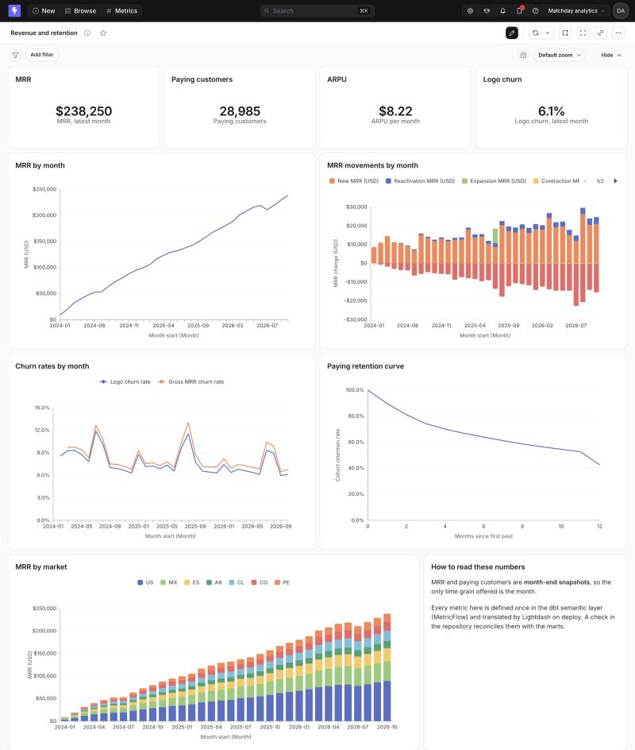

# Subscription Analytics Platform

[](https://github.com/jonatefrias/subscription-analytics-platform/actions/workflows/ci.yml)

An end-to-end analytics engineering project for a **fictional sports-streaming subscription app** ("Matchday+"):
synthetic source data with realistic behaviour and realistic mess → a layered **dbt** project with
contracts, unit tests and reconciliation tests → finance, product, marketing and experimentation marts.

It runs fully locally on **DuckDB** (no cloud account needed). The same project targets **Snowflake** through
a separate profile.

> All data is synthetic and generated by `generator/generate.py`. No real company or customer data is used.

**See the results without running anything:** [analysis reports](https://jonatefrias.github.io/subscription-analytics-platform/)
(revenue, retention, acquisition and the paywall experiment), rebuilt from the models on every merge.

## What it demonstrates

| Area | Where |
|---|---|
| Layered modelling (staging → intermediate → marts), naming conventions | `transform/models/` |
| Handling messy sources: deduplication, at-least-once events, inconsistent codes | `models/staging/` |
| SCD2 price list joined as-of the billing date | `stg_billing__plan_prices`, `int_mrr__subscription_months` |
| Subscription MRR with a full movement bridge (new, reactivation, expansion, contraction, churn) | `fct_mrr_monthly`, `rpt_mrr_bridge` |
| Constant-FX reporting for a multi-currency business | `int_fx__constant_rates`, `int_payments__converted` |
| Incremental model with a lookback window for late-arriving events | `fct_playback_daily` |
| Model contracts on the public marts | `dim_customers`, `fct_subscriptions`, `fct_payments`, `fct_mrr_monthly` |
| dbt unit test for business logic (MRR movement classification) | `models/marts/finance/_finance.yml` |
| Reconciliation tests (bridge adds up, no lost payments, no MRR without a charge) | `transform/tests/` |
| GA4 BigQuery-export events: unnesting `event_params` with one macro per warehouse | `macros/ga4.sql`, `stg_ga4__events` |
| Sessionization, channel grouping and identity stitching (anonymous cookie → customer) | `int_ga4__sessions`, `int_ga4__identity_map` |
| First-touch vs last-non-direct attribution, compared with the CRM channel | `fct_signup_attribution` (unit tested) |
| Tracking coverage vs the CRM (consent gap) with a warn-level test | `rpt_web_tracking_coverage`, `tests/warn_ga4_tracking_coverage.sql` |
| Semantic layer (MetricFlow): 30 metrics, snapshot (semi-additive) MRR, ratios defined once | `models/semantic/` |
| Metric layer reconciled against the marts in CI (34 months x 11 metrics, quarterly snapshots) | `scripts/check_semantic_layer.py` |
| Orchestration with Dagster: raw extracts and every dbt model as assets, dbt tests as asset checks, freshness policies, daily schedule | `orchestration/definitions.py` |
| End-to-end test of the scheduled job on a throw-away copy of the repo | `tests/test_orchestration.py` |
| Linting: sqlfluff rendered through dbt for SQL, ruff for Python | `transform/.sqlfluff`, `pyproject.toml` |
| Pull-request impact report: changed models, downstream models and affected metrics (`state:modified+`) | `scripts/impact_report.py` |
| AI review against written review guidelines, opt-in and free by default | `scripts/ai_review.py`, `docs/review_guidelines.md` |
| MCP server for AI analysts: governed metrics only (no raw SQL), definitions, SQL shown, and a gate that re-derives every number | `semantic_agent/`, `.mcp.json` |
| Experiment readout: decision rule, sample-ratio check, power, confidence intervals, CUPED, revenue horizon, web funnel | `notebooks/paywall_experiment_readout.ipynb`, `analysis/experiment.py` |
| Static analysis reports generated from the semantic layer and the marts, published with GitHub Pages | `reports/`, `.github/workflows/pages.yml` |
| Self-service BI with Lightdash: explores and metrics from the dbt YAML, MetricFlow metrics translated on deploy, dashboards as code, reconciled with the marts | `lightdash/`, `scripts/check_lightdash.py` |
| CI on every pull request: lint, build/test/reconcile, impact report + AI review | `.github/workflows/ci.yml` |

## Architecture

```mermaid
flowchart LR
    subgraph Sources["Raw (Parquet / RAW schema)"]
        crm[crm_customers]
        bill[billing_subscriptions<br/>billing_payments<br/>billing_plans / prices]
        fx[finance_fx_rates]
        app[app_playback_events]
        mkt[marketing_spend]
        exp[experiments_assignments]
        ga4[ga4_events<br/>GA4 export layout]
    end
    subgraph Staging["staging: clean & conform"]
        stg[stg_* views]
    end
    subgraph Intermediate["intermediate: business logic"]
        life[int_subscriptions__lifecycle]
        pay[int_payments__converted]
        mrr[int_mrr__subscription_months]
        sess[int_ga4__sessions<br/>int_ga4__identity_map]
    end
    subgraph Marts
        core[core<br/>dim_customers, dim_plans, dim_date]
        fin[finance<br/>fct_subscriptions, fct_payments,<br/>fct_mrr_monthly, rpt_mrr_bridge]
        prod[product<br/>fct_playback_daily, fct_cohort_retention]
        mk[marketing<br/>fct_acquisition_daily, fct_web_sessions,<br/>fct_web_funnel_daily, fct_signup_attribution]
        ex[experiments<br/>fct_experiment_exposures]
    end
    subgraph Semantic["semantic layer (MetricFlow)"]
        sl[semantic models<br/>metrics, saved queries]
    end
    Sources --> Staging --> Intermediate --> Marts --> Semantic
    Semantic --> mcp(["MCP server: list, describe, query, verify"])
    mcp --> ai(["AI analyst<br/>Claude Code / Desktop"])
    dag(["Dagster: daily_refresh 06:00 UTC<br/>assets, asset checks, freshness"]) -.orchestrates.-> Sources
    dag -.-> Marts
```



## Quickstart

```bash
make setup          # virtualenv + pinned dependencies (Python 3.11)
make data           # ~95k customers, 6M playback events, 1.4M GA4 events (SCALE=0.2 for a quick run)
make build          # dbt deps + dbt build: 33 models, 3 seeds, 99 data tests, 2 unit tests
make metrics        # validate the semantic layer and reconcile it with the marts
make orchestrate    # Dagster UI with the asset graph at http://localhost:3000
make test-orchestration  # run the daily_refresh job end to end on a temp copy
make lint           # sqlfluff + ruff
make review         # print the AI review prompt for the current branch (no API call)
make readout        # re-run the experiment readout notebook against the local warehouse
make reports        # build the static HTML reports into site/
make lightdash      # optional: local Lightdash on the marts with dashboards (needs Docker and Node)
make docs           # dbt docs site with lineage
```

Query metrics from the semantic layer (run inside `transform/` with `DBT_PROFILES_DIR=.`):

```bash
mf query --saved-query mrr_bridge
mf query --metrics mrr,logo_churn_rate --group-by metric_time__quarter
mf query --metrics mrr,arpu --group-by customer__market_code --where "{{ TimeDimension('metric_time', 'month') }} = '2026-10-01'"
mf query --metrics cac --group-by metric_time__month,acquisition_day__acquisition_channel
```

### Ask the data through MCP

`semantic_agent/` is an MCP server over the semantic layer. Open the repo in Claude Code (or add it
to Claude Desktop) and `.mcp.json` registers it. The analyst gets four read-only tools:
`list_metrics`, `describe_metric`, `query_metrics` (returns rows and the generated SQL) and
`verify_number`, which re-derives a number through an independent path before it is reported.
There is no raw-SQL tool: every answer comes from a definition the data team owns. See a real
trace in [docs/agent_demo.md](docs/agent_demo.md).

### Experiment readout

[notebooks/paywall_experiment_readout.ipynb](notebooks/paywall_experiment_readout.ipynb) reads the
paywall A/B test (annual plan highlighted vs not) the way a product team would decide on it. With the
default dataset: the annual share goes from 14.7% to 25.9%, and revenue per signup over 180 days rises
by $6.01 (95% CI $3.69 to $8.34, +18.6%) with paid conversion unharmed, so the variant ships. Two
findings worth the read: the 30-day revenue lift (+53%) is three times the 180-day one because annual
plans prepay twelve months, and CUPED removes only 3% of the variance because new signups have no
pre-period. The statistics are plain functions in `analysis/experiment.py` with unit tests, and CI
executes the notebook on every pull request.

### Explore with Lightdash

`make lightdash` starts a self-hosted [Lightdash](https://www.lightdash.com/) in Docker, publishes the
marts to a local DuckLake, deploys the dbt project and uploads two dashboards kept as code. It is the
only part of the project that needs Docker (and Node for the Lightdash CLI); everything else runs without it.



- **One definition per metric.** The 30 MetricFlow metrics are translated into Lightdash metrics on
  deploy, ratios and derived metrics included, so nothing is defined twice. Lightdash-native metrics
  exist only where MetricFlow has none (cohort retention, the experiment).
- **Explores are an explicit list.** Seven marts carry the `lightdash` tag; staging and intermediate
  models are not exposed.
- **Charts and dashboards as code** in `lightdash/content/`, downloaded with the CLI and linted in CI.
- **Reconciled.** `make lightdash-check` queries the Lightdash API and compares 34 months of 11 metrics
  with `rpt_mrr_bridge`. Its first run found that months without a movement came back null and took
  the gross churn rate with them, which led to a better metric definition (decision 33).
- **A known limit, guarded.** Lightdash has no semi-additive metrics, so MRR is offered at month grain
  only: at quarter grain it would sum three month-end snapshots.

Second dashboard: [acquisition and experiment](docs/img/lightdash-acquisition.jpg). Stop the containers with
`make lightdash-down`; `make lightdash-reset` also deletes the instance's database.

### Analysis reports

`reports/build.py` writes five static pages: an overview, revenue (MRR, its bridge and churn),
retention (cohorts), acquisition (CAC, trial conversion, web funnel, attribution) and the experiment.
MRR, churn, ARPU, CAC and the conversion rates are queried through the semantic layer, so the pages
show the same definitions the project tests; cohorts, attribution and the experiment read the marts.
No number is typed by hand, including the ones in the headlines. `make reports` builds them locally,
CI builds them on every pull request, and a second workflow rebuilds them on the default dataset and
publishes them at <https://jonatefrias.github.io/subscription-analytics-platform/> on every merge.

To run against Snowflake, export the `SNOWFLAKE_*` variables listed in `transform/profiles.yml`, load
the Parquet files into a `RAW` schema, and run `DBT_TARGET=snowflake dbt build`.

## Key definitions

- **MRR** – month-end snapshot of subscriptions that have *started paying* and have not ended. Trials are
  excluded, annual plans count as price / 12, list price in force at the snapshot, converted at a
  **constant budget FX rate**, so currency swings never look like expansion or churn.
- **Movements** – `new` (first MRR ever), `reactivation` (MRR again after a zero month), `expansion`,
  `contraction`, `churn`, `retained`. Every month satisfies
  `opening + new + reactivation + expansion + contraction + churn = closing` (enforced by a test).
- **Trial conversion** – the first subscription had a trial and was charged within 14 days.
- **Web session** – one GA4 cookie (`user_pseudo_id`) + `ga_session_id`. The traffic source is the one on
  the session's first event; spellings are normalised through the `ga4_source_aliases` seed.
- **Identity stitching** – a cookie belongs to the first customer it was seen logged in as, which also
  identifies the anonymous sessions it had before signing up.
- **Attribution** – touchpoints are a customer's stitched sessions up to the signup session.
  First touch = earliest; last non-direct = latest that was not direct.
- **Churn timing** – a cancellation removes MRR when access ends, not when the customer clicks
  "cancel". That is why off-season cancellations show up one month later in the bridge.

- **Metrics** – every ratio (churn rates, ARPU, CAC, trial and web conversion) is defined once in the
  semantic layer, never stored in a mart. MRR and customer counts are snapshot measures: at quarter or
  year grain the semantic layer takes the closing month instead of summing months.

More detail on the trade-offs in [docs/decisions.md](docs/decisions.md). Every tool, how it is used and why it was
chosen over the alternatives: [docs/tooling.md](docs/tooling.md).

## What the data shows (default seed)

The generator plants known behaviours; the marts recover them, which doubles as an end-to-end check:

| Planted behaviour | Recovered in the marts |
|---|---|
| Paid-social trials convert worse | trial conversion 47.7% vs 57–58% for search/organic and 66.8% for referral |
| Monthly price increase in US/MX/ES on 2025-07-01 | +$7.8k expansion MRR in July 2025, then logo churn rises to 9.6% and 11.5% |
| Big-match-day signups churn faster | 27.3% early voluntary churn vs 22.6% |
| Paywall test highlighting the annual plan | annual share 25.9% vs 14.7%; 180-day revenue per signup $38.4 vs $32.4 (30-day: $24.8 vs $16.2) |
| Paying retention | 89% at month 1, 65% at month 6, 44% at month 12 |
| 12% of web visitors decline analytics consent | GA4 records 87.9% of the web signups in the CRM |
| Research visits on a second device stay anonymous | first-touch channel agrees with the CRM for 79.7% of signups |
| Paid-social retargeting between first visit and signup | last-non-direct gives paid social 7.6% more signups than first touch |
| Logins link earlier anonymous visits | a third of the sessions tied to a customer are identified only through stitching |
| The price increase hit only US, MX and ES | August 2025 logo churn 12–13% in those markets vs 8–10% elsewhere (found through the MCP tools) |

## Project structure

```
generator/            synthetic source data (behaviour + planted data-quality issues)
transform/            dbt project
  models/staging/     one model per source table, light cleaning only
  models/intermediate/  reusable business logic, not exposed to BI
  models/marts/       contracted, documented tables for BI and analysis
  models/semantic/    semantic models, metrics and saved queries (MetricFlow)
  tests/              singular reconciliation tests
  seeds/              business calendar, GA4 source aliases, country reference
orchestration/        Dagster definitions: assets, checks, job, schedule
analysis/             experiment statistics (intervals, power, CUPED), unit tested
notebooks/            experiment readout for the paywall A/B test
reports/              generator of the static HTML reports (inline SVG charts, no JS dependencies)
lightdash/            local Lightdash: Docker Compose, first-run setup, charts and dashboards as code
semantic_agent/       MCP server for AI analysts (metric catalog, governed queries, verification gate)
tests/                orchestration, MCP server and experiment statistics tests (pytest)
scripts/              semantic-layer reconciliation, PR impact report, AI review
docs/decisions.md     design decisions and trade-offs
docs/tooling.md       every tool, how it is used and why it was chosen over the alternatives
docs/review_guidelines.md  what every pull request is reviewed against
```

## Roadmap

- [x] Synthetic sources, staging, marts, contracts, unit and reconciliation tests, CI
- [x] Web analytics: GA4 export, sessions, identity stitching, attribution, tracking coverage
- [x] Semantic layer (MetricFlow) with MRR, churn, ARPU, CAC and conversion metrics, reconciled in CI
- [x] Orchestration with Dagster (dbt assets, asset checks, freshness policies, daily schedule), tested end to end in CI
- [x] Linting, PR impact report (`state:modified+` with affected metrics) and AI review in CI
- [ ] Snowflake deployment and slim CI (`dbt build --select state:modified+ --defer`)
- [x] AI layer: MCP server that answers questions through the semantic layer, with a verification gate
- [x] Experiment readout notebook: power analysis, CUPED, confidence intervals, web funnel

## Author

José Oñate, Data & Analytics Manager. Built as a public, reproducible version of the kind of
subscription analytics stack I design and run at work, without any employer data.
